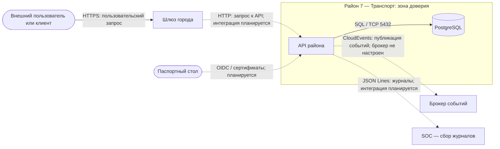

# Архитектура района __7__ — Транспорт

**Команда:** 7 · **Тимлид:** Ефремов Александр Сергеевич · **Версия:** v0 · **Дата:** 19.10.2026

## 1. Назначение
Район «Транспорт» обеспечивает асинхронную передачу событий между районами городской инфраструктуры. Он предназначен для организации обмена сообщениями, маршрутизации событий и повышения устойчивости межрайонного взаимодействия.

## 2. Политика безопасности
Доступ к сервисам района должен предоставляться только через согласованные интерфейсы, а база данных не должна быть напрямую доступна из других районов. Секреты, включая пароль базы данных, хранятся в локальном файле `.env` и не включаются в Git. Межрайонное взаимодействие, аутентификация сервисов и передача журналов должны соответствовать соглашениям безопасности города.

## 3. Компоненты
|     **Компонент (сервис Compose)**     |                      **Что делает**                      |             **Технология**              | **Порт внутри района** |     **Виден другим районам?**      |
| :------------------------------------: | :------------------------------------------------------: | :-------------------------------------: | :--------------------: | :--------------------------------: |
|                  api                   | HTTP API района и проверка доступности через `/health`\| |       Сервис из `./services/api`        |          8080          | Нет, внешняя публикация запрещена  |
|                   db                   |                  Хранение данных района                  |               PostgreSQL                |          5432          | Нет, только внутренняя Docker-сеть |
|            Брокер сообщений            |     Передача и маршрутизация событий между районами      | Выбор технологии на стадии согласования |      Не определён      |  Только по согласованным правилам  |
| Очередь недоставленных сообщений (DLQ) | Хранение событий, обработка которых завершилась ошибкой  |      Брокер на стадии согласования      |      Не определён      |            Планируется             |

## 4. Схема потоков данных (DFD)
Обозначения: `([...])` — внешняя сущность, `[...]` — процесс, `[(...)]` — хранилище,
стрелка — поток данных (подпишите, что передаётся и по какому протоколу),
`subgraph` — зона доверия (граница доверия — край подграфа).

## 5. Границы доверия
| №   |           Граница           |                 Что по разные стороны                 |                     Как контролируется сейчас                     |                   Как будет (неделя)                    |
| --- | :-------------------------: | :---------------------------------------------------: | :---------------------------------------------------------------: | :-----------------------------------------------------: |
| Г1  | Локальный хост → API района |     Локальная среда разработчика / контейнер API      |                 Порт привязан к `127.0.0.1:8080`                  |                    TLS (3); SSO (4)                     |
| Г2  |      API → база данных      |         Прикладной сервис / хранилище данных          | Отдельная внутренняя сеть Docker; порт БД не опубликован на хосте |   Проверить изоляцию БД при запуске; срок уточняется    |
| Г3  |  Другие районы → Транспорт  |       Внешние сервисы города / район Транспорт        |            Межрайонное подключение на этапе настройки             |                         SSO (4)                         |
| Г4  |       Транспорт → SOC       |  Инфраструктура района / система мониторинга города   |               Отправка журналов на этапе настройки                | Настроить передачу журналов JSON Lines; срок уточняется |
| Г5  |    API → брокер событий     | Прикладной сервис / инфраструктура обмена сообщениями |                      Брокер пока не настроен                      | Подпись событий (неделя 5); сегментация сети (неделя 6) |

## 6. Внешние зависимости
| От кого зависим | Что получаем                                                                                            | Что будет, если он недоступен или скомпрометирован                                                                                                                                                                                                                     |
| --------------- | ------------------------------------------------------------------------------------------------------- | ---------------------------------------------------------------------------------------------------------------------------------------------------------------------------------------------------------------------------------------------------------------------- |
| Паспортный стол | Предусмотренные архитектурой города механизмы пользовательской аутентификации и сведения о сертификатах | Недоступность может нарушить вход пользователей или проверку удостоверяющих данных после внедрения интеграции                                                                                                                                                          |
| Транспорт       | Доставка событий                                                                                        | При недоступности Транспорта события могут задерживаться или не доставляться получателям, что нарушит обмен данными между районами. При компрометации злоумышленник может подменять, перехватывать или повторно отправлять события, а также нарушать их маршрутизацию. |
| SOC             | Приём журналов                                                                                          | При недоступности SOC мониторинг может потерять часть журналов или получать их с задержкой                                                                                                                                                                             |
| Брокер событий  | Возможность публиковать и получать события                                                              | При недоступности возможны задержки или сбои доставки событий; последствия зависят от выбранного брокера и механизма повторных попыток                                                                                                                                 |
## 7. Угроза D — отказ в обслуживании (DoS)

**Сценарий:** поток запросов исчерпывает ресурсы API или переполняет очередь, из-за чего легитимные запросы обрабатываются с задержкой либо отклоняются.

**Меры защиты:**

- Ограничение частоты запросов и времени обработки.

- Лимиты параллельных запросов и размера сообщений.

- Ограничение длины очередей и контроль потребления ресурсов.

- Мониторинг нагрузки, ошибок и доступности `/health`.

- При перегрузке — отказ от избыточной работы и контролируемое восстановление.

## 8. Секреты и доступ

- Секреты хранятся в `.env`, который исключён из Git.

- БД доступна только внутренним компонентам.

- Межрайонный доступ разрешается только через согласованные интерфейсы.

- Аутентификация, авторизация и аудит настраиваются по городским требованиям.
## 9. Соответствие соглашениям города
- [ ] Имена по Р1 (`d__N__-__CODE__`, `*.__CODE__.city.lab`)
- [ ] Время UTC (Р3)
- [ ] Журналы JSON Lines с обязательными полями (Р4)
- [ ] События в конверте CloudEvents (Р5), описаны в `contracts/events.md`
- [ ] API описан в `contracts/openapi.yaml`, есть `/health` (Р6)
- [ ] Секретов в Git нет (Р7)
